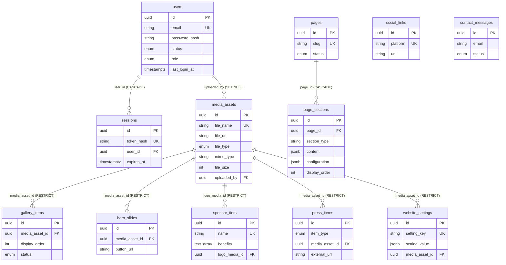

# Jinnah League — Database Architecture

PostgreSQL on Neon · Prisma ORM 7 · schema: `backend/prisma/schema.prisma`

**Status: schema validated (`prisma validate` passes, client generates) and exercised by the backend test suite on a local
PostgreSQL 16. The Neon project exists (Singapore) but the migration has NOT been applied to it yet — run
`npx prisma migrate deploy` from `backend/`.**

`prisma/migrations/20261031000000_init/migration.sql` was written by hand (Prisma's migration engine cannot be downloaded in
the sandbox where it was authored). Run `npx prisma migrate dev` once on your machine afterwards: if it reports drift,
the schema and SQL differ and it will generate a corrective migration.

## ERD



## Key design decisions

| Decision | Reason |
|---|---|
| UUID primary keys generated by PostgreSQL (`gen_random_uuid()`) | Non-guessable ids in public URLs; also works for seeds and raw SQL. |
| Postgres enums for fixed state (`status`, `role`, `file_type`, `item_type`) | Invalid values are impossible at database level. |
| `section_type` and `social_links.platform` are validated strings, not enums | New section types / platforms are added without a migration. |
| JSONB only for `page_sections.content/configuration` and `website_settings.setting_value` | Genuinely flexible shapes. Everything relational stays in real columns. |
| Media references use `ON DELETE RESTRICT` | A file still used by a slide, tier, gallery item, press item or setting cannot be deleted by accident. The CMS will say where it is used. |
| `page_sections.page_id` uses `ON DELETE CASCADE` | Sections are owned by their page. |
| `media_assets.uploaded_by` uses `ON DELETE SET NULL` | Removing an admin never deletes uploaded files. |
| `users.role` enum (`SUPER_ADMIN`, `ADMIN`, `EDITOR`) | Cheap RBAC foundation; can later become a roles table. |
| `website_settings` has a nullable `media_asset_id` | Logo and favicon stay referentially protected instead of being a loose id inside JSON. |
| Default `status` is `DRAFT` | Nothing appears publicly until an admin publishes it. |
| Neon: pooled `DATABASE_URL` at runtime, direct `DIRECT_URL` for migrations | Migrations need a session-level connection; the pooler is for app traffic. |

### Columns added beyond the suggested list (please confirm)

- `users.role` — RBAC foundation.
- `press_items.source_name`, `press_items.published_on` — press coverage needs an outlet and a date.
- `website_settings.setting_group` and `website_settings.media_asset_id` — settings screen grouping and protected logo/favicon.

### Added with the backend spec

- **`sessions` table** (PostgreSQL-backed sessions): hashed token, CSRF token, `user_id` (CASCADE), idle expiry, IP, user agent.
  Lets a password change or a disabled account revoke sessions instantly.
- `message_status` is `UNREAD | READ | RESOLVED` (was `ARCHIVED`) to match "mark as resolved".

### Not included

- A table of individual sponsors/logos per tier — the approved scope only lists tiers.
- Activity logging — the dashboard shows real counts only, nothing fabricated.

## Setup

Environment variables are documented in `backend/.env.example`.

```bash
cd backend
npm ci
cp .env.example .env            # DATABASE_URL (pooled) + DIRECT_URL (direct)
npx prisma migrate deploy       # applies the committed init migration to Neon
npm run build                   # prisma generate
npm run seed                    # first admin + system pages (set ADMIN_EMAIL / ADMIN_PASSWORD)
npm run dev
curl http://localhost:5000/api/health/db   # expect {"success":true,"data":{"database":"connected"}}
```

Production: `npx prisma migrate deploy` (never `migrate dev`). Use a separate Neon branch for development so
production data is never touched by experiments.
